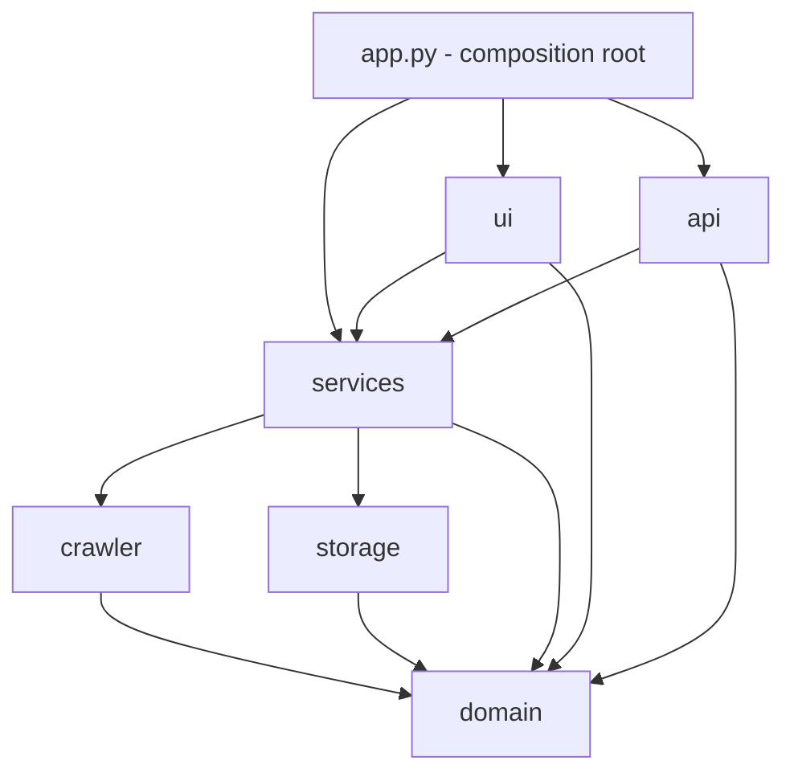
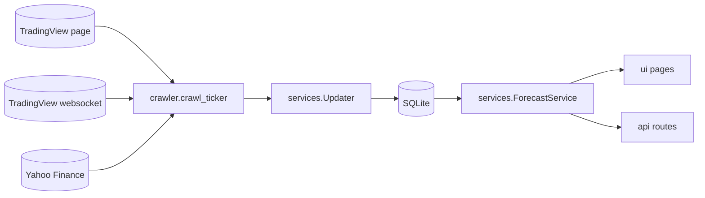
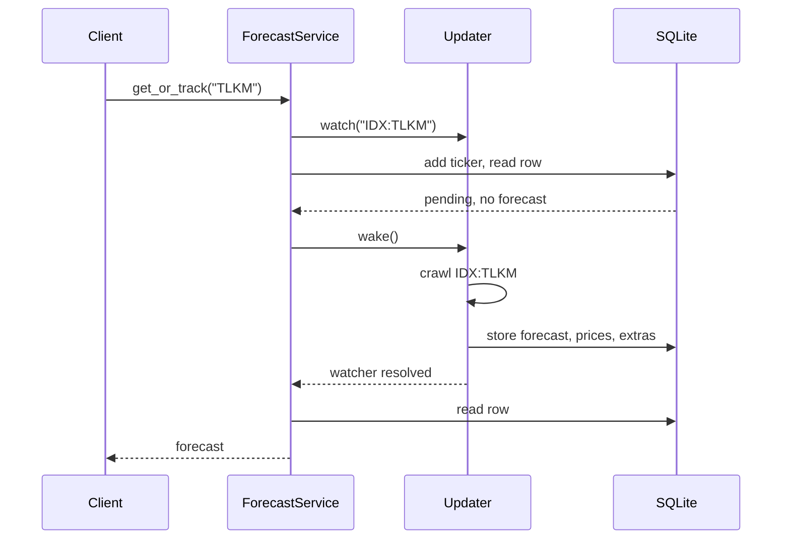

# Architecture

LiveStocks is one Python process. A NiceGUI web server serves the dashboard and the HTTP API, and a background
loop inside the same process crawls TradingView. Everything is stored in one SQLite file.

## Layers

The code is split into subsystems that depend on each other in one direction only:

| Subsystem | Responsibility | May import |
|---|---|---|
| `domain` | Value objects (`Forecast`, `Extras`, `TrackedTicker`), ticker parsing, rating rules. No I/O. | nothing |
| `crawler` | Fetching and parsing TradingView and Yahoo data, retries. Knows nothing about the database. | `domain` |
| `storage` | SQLite persistence and schema migrations. Knows nothing about the internet. | `domain` |
| `services` | The updater loop and `ForecastService`, the single entry point for everything above. | `domain`, `crawler`, `storage` |
| `api` | HTTP routes, response models and error mapping. | `domain`, `services` |
| `ui` | NiceGUI pages and HTML/chart builders. | `domain`, `services` |

`services`, `api` and `ui` may also read `livestocks.config`. Two rules keep this honest, and `tests/unit/test_architecture.py` enforces both:

1. **Direction.** The table above is the whole list of allowed imports. In particular `ui` and `api` never touch
   `storage` or `crawler`; they go through `ForecastService`.
2. **Package roots.** Other subsystems import from the package (`from livestocks.domain import Forecast`), never from
   a module inside it. Inside a package, modules import each other directly.

Every subsystem has the same files: `__init__.py` (the public names), `models.py` (its data types) and `errors.py`
(its exceptions), plus modules for its behaviour. The architecture test checks that too, so a new subsystem starts
from the same shape.

## Data flow

`crawl_ticker` fetches the forecast page first (required), then the price history and the EPS/revenue extras
concurrently (optional). A failed optional part is recorded in the result and never loses the forecast.

## The updater

`Updater` runs a loop that wakes every `LIVESTOCKS_POLL_INTERVAL` seconds, or immediately when something calls
`wake()`. Each pass starts one task for every ticker that is due and not already being crawled; a semaphore limits how
many crawl at once. Because a pass only starts tasks and returns, a ticker added while slow crawls are running starts
at once instead of waiting for them.

Scheduling lives in the database: every ticker has a `next_fetch` time, a failure counter and a `dead` flag, so the
schedule survives restarts. A failure backs off exponentially and records an `ErrorKind` (`not_found` or `upstream`).

## One request for a new ticker

`ForecastService.get_or_track` is what the HTTP endpoint calls:

The service registers its watcher *before* reading the database, so a crawl that finishes in between cannot be missed.
Several simultaneous requests for the same new ticker share one crawl. If the wait exceeds
`LIVESTOCKS_API_WAIT_SECONDS` the request fails with a timeout while the crawl carries on in the background.

## Persistence

`storage.Store` wraps one SQLite connection behind a lock. The schema is versioned with `PRAGMA user_version`:
`storage/migrations.py` lists the SQL steps in order and applies the pending ones when a `Store` is opened. A database
that predates versioning is adopted by the idempotent first step, and a database written by a newer release is rejected
instead of being damaged.

| Table | Content |
|---|---|
| `tickers` | Tracked tickers with their schedule and failure state. |
| `forecasts` | One row per crawl: the history of targets and ratings. |
| `prices` | Daily closes, replaced by timestamp on every crawl. |
| `extras` | The latest EPS, revenue and rating counts as JSON. |
